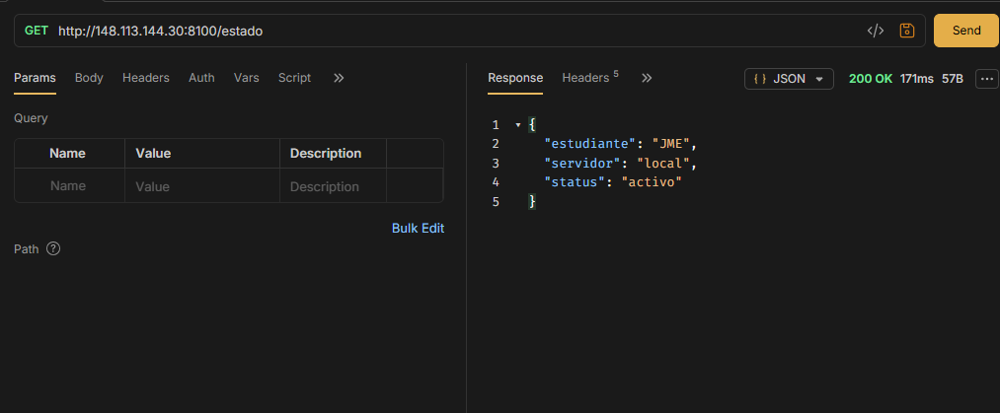
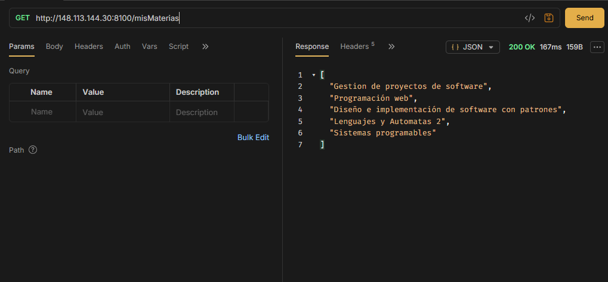

# Actividad 1 - Tema 4: Introducción a Spring Boot - Configuración y Primeros Controladores

## Autor: Jiménez Mendoza Eduardo

##  Tecnologías Utilizadas
* **Java 17**
* **Spring Boot** (Spring Web)
* **Maven** (Gestión de dependencias)
* **Nginx** (Proxy reverso en el VPS)
* **Git y GitHub**

## Estructura de Controladores y Endpoints
El proyecto cuenta con al menos dos controladores propios que agrupan tres endpoints principales:

1. **`EjemploController.java`**
   * `GET /eduardo/proyecto` -> Regresa el identificador del proyecto y autor.
2. **`DetallesController.java`**
   * `GET /eduardo/materias` -> Regresa un listado simulado de materias de la carrera.
   * `GET /eduardo/estado` -> Regresa un objeto JSON con el estado actual del servicio.

## Enlaces de Acceso y Pruebas
* **Repositorio de GitHub:** https://github.com/evkaal/JMEact1_t4.git
* **Proyecto en producción (VPS):**
  * Proyecto: `http://148.113.144.30:8100/proyecto`
  * Materias: `http://148.113.144.30:8100/misMaterias`
  * Estado: `http://148.113.144.30:8100/estado`

## Pruebas en bruno con los links de la vps

